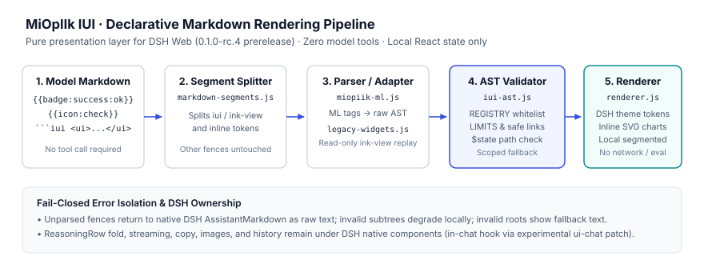

# MiOpIIk IUI


**English** | [简体中文](README.zh-CN.md)

> **Version 0.1.0-rc.11 — prerelease.**
> This release candidate is unpublished on npm and is an independent plugin outside DeepSeek Harness upstream. In-chat rendering requires an **unofficial, version-coupled patch** of `@deepseek-ai/dsh-client-ui-chat`. See [Release status](#release-status).

MiOpIIk IUI is a presentation-only plugin for DeepSeek Harness (DSH) Web. Models write standard Markdown containing trusted inline tokens and fenced `iui` blocks; the browser renders those fragments as declarative interface components. The plugin operates independently of the MiOpIIk Mind/Ink/Operator agent, stores no ledger, and registers no model tools.

Messages, reasoning folds, images, history, streaming, copy, and accessibility remain under DSH's native chat components.

- Inline tokens: `{{badge:success:passed}}`, `{{icon:check}}`, `{{code:npm test}}`
- Fenced `iui` blocks written in `miopiik-ml` or as a validated `iui/1` JSON AST
- A fixed whitelist of declarative components, local `$state` bindings, and browser-local interaction controls (`segmented`, `toggle`, `slider`, `input`) with `when`/`is` visibility gates and table `filter`
- Read-only replay of legacy `ink-view` widget JSON so historical sessions preserve their content
- A DSH plugin page holding everything adjustable or worth seeing: the browser-local render switch, a live preview, a one-line status, and a copyable Markdown sample

Models can only emit whitelisted declarative tags and data; arbitrary HTML, JavaScript, CSS, network requests, tool calls, and model round-trips are blocked by the parser and validator.

## Release status

**Version 0.1.0-rc.11** is a prerelease. Four blockers remain before a `0.1.0` stable release:

1. **Unofficial, version-coupled host patch.** In-chat rendering requires a local fork of `@deepseek-ai/dsh-client-ui-chat`, generated by [tools/fork-chat-embeds.mjs](tools/fork-chat-embeds.mjs) against a specific DSH build (`0.2.2-rc.1`). DSH upstream provides no Markdown embed API. Without the patch, `iui` fences in chat render as standard code blocks, while the live preview on the plugin page remains active and the settings page reports that no patch was detected.
2. **Lossy cross-token Markdown.** Trusted fragments split the Markdown text node, so inline formatting (such as bold or italic), text selection/copy, and screen-reader reading order across a token boundary differ from single-node Markdown.
3. **Non-incremental streaming.** An unclosed `iui` fence displays as plain text while streaming and renders as a component block once the closing fence arrives.
4. **No multi-version compatibility matrix.** Verification covers DSH `0.2.2-rc.1` only, without automated compatibility checks across multiple DSH versions or clean cold-start profile lifecycle runs.

See [docs/IUI-V1-RELEASE-CANDIDATE.md](docs/IUI-V1-RELEASE-CANDIDATE.md) for the v1 release candidate gates and [docs/RELEASE-NOTES.md](docs/RELEASE-NOTES.md) for the per-version blocker list.

## Compared with MiOpIIk Agent

The MiOpIIk project consists of two independent repositories. Either or both packages can be installed.

| | **MiOpIIk IUI** (this repository) | **MiOpIIk Agent** |
|---|---|---|
| Package | `miopiik-iui` 0.1.0-rc.11, prerelease | `miopiik-dsh` 0.1.2, stable |
| Layer | Presentation only: trusted Markdown fragments in the browser | Host side: memory, governance, background execution |
| Main surface | Inline tokens, `iui` fences, declarative components, local state | `ink_*` tool surface, inbox/facts/loops/branches ledger, operator dispatch |
| State | One browser-local render preference in `localStorage` | Append-only JSONL ledger under `<workspace>/.dsh/miopiik/` |
| Model tools | None | 14 (`12` Mind + `2` Operator) |
| Chat ownership | Native DSH `AssistantMarkdown` / `ReasoningRow` | Session views, right sidebar, plugin/settings pages; no IUI rendering |
| Install requirement | DSH Web profile; experimental chat patch for in-chat rendering | DSH Web profile |
| Repository | https://github.com/Chillizu/miopiik-iui | <https://github.com/Chillizu/miopiik> |

### Repository split

This repository was extracted from the former MiOpIIk monorepo with `git subtree split -P miopiik-iui`, preserving the 13 IUI commits. The Agent package lives in <https://github.com/Chillizu/miopiik>. Pre-split release tags in the monorepo used the `miopiik-iui-v...` prefix and their release assets remain valid. Historical session data requires zero migration: legacy `ink-view` content is mapped read-only at render time (see [Legacy replay](#legacy-ink-view-replay)). Full provenance details are in [docs/MIGRATION.md](docs/MIGRATION.md).

## Architecture



```text
model output (plain Markdown from the model)
  |
  |  shared/markdown-segments.js   split fenced iui / ink-view and inline tokens;
  |                                other code fences and inline code are left untouched
  v
  L-- shared/miopiik-ml.js         iui fence in miopiik-ml -> raw AST document
  |   (or iui/1 JSON fence)        JSON AST is kept for debugging/compatibility
  v
  shared/iui-ast.js                validateAst(): component whitelist, props,
  |                                binding paths, budgets, safe links, local degrade
  v
  renderer.js                      React component registry; theme tokens, inline SVG
  |
  v
browser                            local React state only; no network, no model round-trip
```

Files and responsibilities:

| File | Role |
|---|---|
| [index.js](index.js) | Host entry. Injects one system-prompt section (`miopiik-iui:render-contract`, order 670, interpolation disabled) with the output convention. Registers no tools. |
| [shared/markdown-segments.js](shared/markdown-segments.js) | Stateless splitter for fenced blocks and inline tokens. Recognizes a line-start top-level `<ui>...</ui>` block when a fence is omitted. |
| [shared/miopiik-ml.js](shared/miopiik-ml.js) | Parser for the `miopiik-ml` tag grammar; produces an unvalidated AST document. |
| [shared/iui-ast.js](shared/iui-ast.js) | Validator for `iui/1`: `REGISTRY` whitelist, `LIMITS`, binding parser, table/chart normalization, and local degradation. |
| [shared/legacy-widgets.js](shared/legacy-widgets.js) | Read-only adapter mapping retired seven-widget `ink-view` JSON specs into `iui/1`. |
| [renderer.js](renderer.js) | React renderer for validated ASTs and inline primitives. Bundled into `client.js`. |
| [settings.js](settings.js) | The single DSH UI surface (`plugins.bundle.config`, key `miopiik-iui`): render switch, live preview, status line, and copyable sample. |
| [client.js](client.js) | Generated browser bundle. Regenerate with `node tools/build.mjs`. |
| [cordis.patch.yml](cordis.patch.yml) | Bundle patch used by the DSH profile to load the plugin. |

### Host-side patch

To render fragments inside chat messages without an upstream DSH Markdown embed API, the repository includes a deterministic patch generator:

1. [tools/fork-chat-embeds.mjs](tools/fork-chat-embeds.mjs) copies the installed `@deepseek-ai/dsh-client-ui-chat` package into `upstream/dsh-client-ui-chat-embeds/` (generated output, gitignored) and inserts a single hook in the `case "text"` branch of `AssistantMarkdown`.
2. It writes the unified diff to [patches/chat-markdown-embeds.patch](patches/chat-markdown-embeds.patch), runs `node --check` on the modified file, and symlinks the fork's `node_modules` to the DSH dependency tree.
3. Native `AssistantMarkdown`, `ReasoningRow` (fold, summary, streaming, accessibility), images, attachments, copy, and replay stay under DSH's components; only text fragments matching trusted markers are passed to the plugin.
4. The hook is fail-closed: if the plugin registry is absent, the browser preference is disabled, or rendering throws, the fragment falls back to native Markdown or plain text. The hook sets `globalThis.__miopiikMarkdownEmbedsHost = true` so the settings page can report whether the patch is active.

Because the generator matches exact source anchors in `@deepseek-ai/dsh-client-ui-chat`, the fork is coupled to the installed DSH version and exits with an error if the upstream file changes. Regenerate the fork after upgrading DSH, and link it only inside the target profile's `node_modules`.

## What you can write

### Inline tokens

Inline tokens can appear anywhere in a paragraph:

| Token | Meaning |
|---|---|
| `{{badge:success:passed}}` | Badge with tone `neutral`, `success`, `warning`, or `danger`, followed by text. Omitting the tone (`{{badge:draft}}`) defaults to `neutral`. |
| `{{icon:check}}` | Icon by name: `check`, `alert`, `dot`, `arrow-right`, `spark`, `chart`, `layers`, `shield`, `clock`, `inbox`, `info`. Unknown names fall back to `dot`. |
| `{{code:npm test}}` | Inline monospace text rendered literally. |

Payloads are capped at 120 characters without braces or newlines. Other fenced code blocks are ignored by the splitter; inline tokens inside single-backtick inline code are still matched (see [Limitations](#limitations)).

### Fenced `iui` blocks

Use the fence info string `iui`. Two input formats are supported:

- **`miopiik-ml`** (primary): an XML-like tag grammar compiled to an AST and passed to `validateAst`.
- **`iui/1` JSON AST**: a JSON object with a `root` node, supported for debugging and compatibility and validated by the same pipeline.

`miopiik-ml` maps tags to components, attributes to props, JSON literals to structured values, and `$state.*` strings to local state bindings:

```iui
<ui title="Weekly activity" fallback="Mon 12, Tue 19">
  <state name="range" value='{"total":"31"}'/>
  <column gap="md">
    <metric label="Total" value="$state.range.total" unit="visits"/>
    <chart kind="line" series='[["Mon",12],["Tue",19]]' source="demo data"/>
  </column>
</ui>
```

Grammar rules:

- Root element is `<ui>`, with optional `title` and `fallback` attributes. `fallback` is displayed if the root block fails validation.
- `<state>` accepts either `<state name="range" value='{"...":...}'/>` or a JSON body `<state>{"range":{...}}</state>`.
- Attribute values can be quoted strings, JSON literals (`options='[...]'`, `rows='[...]'`), numbers, booleans, or `$state.*` binding paths.
- `gap` accepts `none`, `xs`, `sm`, `md`, `lg`, `xl`, or a number. `chart` accepts `kind="bar"`, `kind="line"`, or `kind="donut"`; legacy `type`/`data` attributes normalize to `kind`/`series`.
- A bare top-level `<ui>...</ui>` starting at column 0 is also accepted as a fallback when fences are omitted.

### Component catalog

| Component | ML tag | Notes |
|---|---|---|
| Root | `ui` | Wraps one block; `title`, `fallback`. |
| State declaration | `state` | Declares local initial values; produces no DOM node. |
| Text | `text` | Plain text node. |
| Paragraph | `p`, `paragraph` | Contains inline primitives only: `text`, `badge`, `icon`, `emphasis`, `code`, `link`. |
| Badge | `badge` | `text`, `tone` (`neutral`, `success`, `warning`, `danger`, `info`, `accent`). Usable inline or as a block. |
| Icon | `icon` | Inline primitive inside `p`/`paragraph`, or `empty.icon`. `name`, `label`. |
| Emphasis | `b`, `emphasis` | Inline primitive inside `p`/`paragraph`. `text`, `strong`. |
| Code | `code` | Inline primitive inside `p`/`paragraph`. `text`; inline monospace. |
| Link | `a`, `link` | Inline primitive inside `p`/`paragraph`. `text`, `href` (`https://...`, `/...`, or `#anchor` only). |
| Row / Column | `row`, `column` | Layout containers; `gap`, `align`. |
| Grid | `grid` | `columns` 1-6, `gap`, `align`. |
| Card | `card` | `title`, `subtitle`, `gap`, `span`, `align`; container. |
| Divider | `divider` | Optional `label`. |
| Metric | `metric` | `label`, `value`, `unit`, `delta`, `caption`/`note`, `tone`. Supports `$state` bindings. |
| Table | `table` | `columns` (1-12 strings or `{key,label}` objects), `rows` (up to 200 arrays or objects), `caption`, `filter` (`$state.*` binding for browser-local text filtering). |
| Chart | `chart` | `kind` (`bar`, `line`, or `donut`), `series` (point array or `$state` binding), `source`. Rendered as inline SVG. |
| Progress | `progress` | `value` >= 0 (number or `$state` binding), `max` > 0, `label`, `tone`. |
| Callout | `callout` | `tone`, `title`, `text`; accepts child nodes. |
| Empty | `empty` | `text`/`title`/`description`, `icon`. |
| Segmented | `segmented` | Local state switcher; `bind` (`$state.*`), 1-6 `options`, `label`. |
| Toggle | `toggle` | Boolean control writing `$state.*`; `bind`, `label`. |
| Slider | `slider` | Numeric control writing `$state.*`; `bind`, `min`, `max`, `step` (positive), `unit`, `label`. |
| Input | `input` | Text control writing `$state.*` (capped at the per-node text budget); `bind`, `placeholder`, `label`. |
| Steps | `steps` | Ordered process list; accepts `step` children only. |
| Step | `step` | `title` (required), `note`, `tone` (shared six-tone enum). |
| Diagram | `diagram` | Lane-based structural graph; `title`, `source`. Lanes ≤ 6, nodes ≤ 24, edges ≤ 24. |
| Lane | `lane` | One column; accepts `node` children only (1-8). |
| Diagram node | `node` | `id` (required, unique per diagram, safe identifier), `label` (required), `tone`, `note`. May also sit directly in `diagram` (collected into the first lane). |
| Diagram edge | `edge` | `from`/`to` (node ids), `label`, `kind` (`solid` default / `dashed`). Unknown ids degrade that edge only; plain text lines render as annotations. |

Any component may carry `when="$state.*"` (optionally with `is="value"` for equality switching) to gate its own visibility against local state. The component whitelist is defined by `REGISTRY` in [shared/iui-ast.js](shared/iui-ast.js). Unlisted tag names degrade locally.

### Local state and bindings

Bindings support dot-path reads only: `$state.a.b` and `$data.a.b`. Expression evaluation, function calls, and `eval` are absent. Interaction follows one model: **controls write `$state`, everything else reads it**. `segmented` (single choice), `toggle` (boolean), `slider` (number), and `input` (text) write their value to a `$state.*` path; any attribute may read `$state.*`; `when`/`is` gates node visibility; `table filter` filters rows locally. Every interaction updates local React state within the current message and re-renders bound nodes without sending network requests, invoking tools, or starting a model turn. The `data` scope is currently empty (`$data.*` resolves to `undefined`) and is reserved for future read-only data injection.

### Legacy `ink-view` replay

The legacy `ink-view` seven-widget protocol (`dataset`, `graph`, `timeline`, `text`, `choice`, `media`, `layout`) is retired. Historical session logs require zero migration: `shared/legacy-widgets.js` maps fenced `ink-view` JSON specs read-only into `iui/1` AST nodes before validation. Unmappable specs remain as raw text (the current render path does not use the old spec's `fallback` field), `choice` actions render as static labels, and nothing is written back to session logs or ledgers. The retired design is archived in [docs/EXTRA-UI.md](docs/EXTRA-UI.md).

### Plugin page

The plugin registers a single DSH UI surface: **Plugins → Installed → MiOpIIk IUI** (`plugins.bundle.config`). Everything the user can adjust or wants to see lives on this one page — no settings tab, no essays:

- **Render switch**: the browser-local "show IUI in chat" preference (one switch, saved to `localStorage`, reloads the page so historical messages re-render).
- **Live preview**: rendered with the real renderer and sample data; switching only changes local state.
- **Status line**: plugin version, host patch state (loaded / not detected), renderer connection.
- **Copyable sample**: a ready-to-paste Markdown snippet.

### Validation, budgets and error isolation

`validateAst` enforces all structural and size constraints:

- Component whitelist and per-component prop normalization.
- Budgets: 120 nodes, max depth 6, 60 chart points, 6 segmented options, 2000 characters per text node, 16384 bytes for state/table payloads, 200 table rows, and 12 columns.
- Prototype-pollution keys (`__proto__`, `constructor`, `prototype`) are rejected in bindings, state objects, and table rows.
- Invalid root nodes, depth overflows, or node-count overflows reject the entire block (fail-closed) and display the block's `fallback` string.
- Fences that fail syntax parsing return to native Markdown as raw text.
- An invalid child subtree degrades to a single fallback text node while sibling and parent nodes continue to render.
- Any runtime exception at the embed hook boundary falls back to a `<span data-miopiik-embed-fallback>` element.

## Examples

Models emit IUI directly in their Markdown replies without calling tools.

Inline tokens in prose:

~~~md
Build {{badge:success:passed}}, duration {{badge:neutral:42s}}; status {{icon:check}}.
Local check: {{code:npm test}}
~~~

A fenced `iui` block with local state, metrics, a chart, a table, and a segmented control:

~~~md
This release check finished {{badge:success:2/3}}:

```iui
<ui title="Release checks" fallback="3 checks this round: parse passed, validate passed, render under observation">
  <state name="range" value='{"total":"3","passed":"2","series":[["Parse",12],["Validate",9],["Render",7]]}'/>
  <column gap="md">
    <row gap="md">
      <metric label="Checks" value="$state.range.total" unit="items"/>
      <metric label="Passed" value="$state.range.passed" unit="items" tone="success" delta="+1"/>
    </row>
    <segmented label="Round" bind="$state.range" options='[{"label":"This round","value":{"total":"3","passed":"2","series":[["Parse",12],["Validate",9],["Render",7]]}},{"label":"Previous","value":{"total":"3","passed":"1","series":[["Parse",11],["Validate",8],["Render",6]]}}]'/>
    <grid columns="2">
      <chart kind="bar" series="$state.range.series" source="demo data"/>
      <table columns='["Check","Result"]' rows='[["Parse","passed"],["Validate","passed"],["Render","observing"]]'/>
    </grid>
  </column>
</ui>
```
~~~

An equivalent `iui/1` JSON AST block:

~~~md
```iui
{"version":"iui/1","title":"Component usage","fallback":"Component usage: metric 2, chart 1","state":{},"root":{"id":"root","type":"column","props":{"gap":10},"children":[{"id":"m1","type":"metric","props":{"label":"Components","value":"3","unit":"items"},"children":[]},{"id":"t1","type":"table","props":{"columns":["Type","Count"],"rows":[["metric",2],["chart",1]]},"children":[]}]}}
```
~~~

The system-prompt section injected by [index.js](index.js) instructs the model to default to standard Markdown and use IUI only for data comparisons, trends, or local view switching, without inspecting source files or running tools for UI rendering. Background findings are recorded in [docs/IUI-NATURAL-OUTPUT-AUDIT.md](docs/IUI-NATURAL-OUTPUT-AUDIT.md).

## Compatibility

| Item | Requirement |
|---|---|
| DSH | DSH Web only (`web` profile). Test baseline: DSH `0.2.2-rc.1`. |
| Node.js | `>= 23.6` (`package.json` `engines`). |
| DSH CLI | `dsh plugin --profile <profile> add/remove`. |
| Browser | Chromium (used by isolated DOM tests). |

Full support details are in [docs/SUPPORT-MATRIX.md](docs/SUPPORT-MATRIX.md).

## Install, upgrade, rollback

`0.1.0-rc.11` is a **prerelease** and requires a local host patch for in-chat rendering. Install it into a profile where you can manage `node_modules` links and restart the DSH Web process.

### Prerequisites

- A DSH Web installation (`0.2.2-rc.1` baseline) with a modifiable profile.
- Node.js `>= 23.6` and `dsh` on `PATH`.
- A local checkout of this repository.

### Install

1. Add the plugin to the target profile:

   ```sh
   dsh plugin --profile <profile> add /absolute/path/to/miopiik-iui
   ```

   Or install from a local tarball:

   ```sh
   npm pack --pack-destination .dsh/tmp/packs
   dsh plugin --profile <profile> add .dsh/tmp/packs/miopiik-iui-0.1.0-rc.11.tgz
   ```

   You can also use [tools/install-plugin.mjs](tools/install-plugin.mjs), which defaults to dry-run and requires `--allow-running-profile` before modifying the `web` profile:

   ```sh
   node tools/install-plugin.mjs --profile <profile> --mode link            # dry-run
   node tools/install-plugin.mjs --profile <profile> --mode link --execute  # execute
   ```

2. Verify that `client.js` matches its sources:

   ```sh
   node tools/build.mjs --check
   ```

3. Generate the patched `ui-chat` fork from the installed DSH package (auto-detected in standard global npm prefixes, or specified via `MIOPIIK_DSH_DIR`):

   ```sh
   MIOPIIK_DSH_DIR=/path/to/dsh/installation node tools/fork-chat-embeds.mjs
   MIOPIIK_DSH_DIR=/path/to/dsh/installation node tools/fork-chat-embeds.mjs --check
   ```

   The generated fork is written to `upstream/dsh-client-ui-chat-embeds/` (gitignored) and the diff to [patches/chat-markdown-embeds.patch](patches/chat-markdown-embeds.patch) (overridable via `MIOPIIK_FORK_DIR` and `MIOPIIK_FORK_PATCH`). `--check` is read-only and exits `0` when no DSH installation or fork is present. Generate or update the fork only while no active DSH task is loading it. See [docs/UPSTREAM-MARKDOWN-EMBED.md](docs/UPSTREAM-MARKDOWN-EMBED.md) for details.

4. Point the target profile's `@deepseek-ai/dsh-client-ui-chat` symlink at the generated fork (leave the global DSH installation unchanged):

   ```sh
   cd <profile>/node_modules/@deepseek-ai
   [ -e dsh-client-ui-chat ] && mv dsh-client-ui-chat dsh-client-ui-chat.bak
   ln -s /absolute/path/to/miopiik-iui/upstream/dsh-client-ui-chat-embeds dsh-client-ui-chat
   ```

5. Restart DSH Web for that profile and reload the browser. Open **Plugins -> Installed -> MiOpIIk IUI** to verify the active status.

### Upgrade

1. Install the updated checkout or tarball (`dsh plugin --profile <profile> add <new-checkout-or-tarball>`).
2. Run `node tools/build.mjs --check`.
3. If the DSH version changed, rerun `node tools/fork-chat-embeds.mjs` and `node tools/fork-chat-embeds.mjs --check`.
4. Restart DSH Web. Existing session messages render with the updated bundle on next load.

### Uninstall

1. Remove the plugin from the profile:

   ```sh
   dsh plugin --profile <profile> remove miopiik-iui
   ```

2. Restore `<profile>/node_modules/@deepseek-ai/dsh-client-ui-chat` from `dsh-client-ui-chat.bak`.
3. Restart DSH Web. Chat messages return to standard Markdown rendering.

### Rollback

- **Browser-local disable (no restart):** toggle rendering off under **Plugins → Installed → MiOpIIk IUI**, or run in the browser console:

  ```js
  localStorage.setItem("miopiik.markdownEmbeds", "0"); location.reload()
  ```

- **Full profile rollback:** remove the plugin and restore `dsh-client-ui-chat.bak` as shown in [Uninstall](#uninstall), then restart DSH Web.

### Without the host patch

When `miopiik-iui` is installed without the `ui-chat` fork:

- `iui` fences in chat render as standard fenced code blocks and inline tokens remain literal text.
- The plugin page and its live preview continue to render locally.
- The settings page diagnostics report `no patch detected`.
- The host prompt convention remains active; any IUI blocks emitted by the model display as code blocks until the patch is linked.

## Configuration

| Knob | Location | Effect |
|---|---|---|
| `miopiik.markdownEmbeds` | Browser `localStorage` | `"0"` disables in-chat IUI rendering in the current browser; any other value (or unset) enables it. Toggling reloads the page. |
| Render switch (UI) | **Plugins → Installed → MiOpIIk IUI** | Browser-local toggle for `miopiik.markdownEmbeds`. |
| `globalThis.__miopiikMarkdownEmbedsHost` | Browser `globalThis` | Set to `true` by the patched `ui-chat` hook; read by settings diagnostics. |
| `globalThis.__miopiikMarkdownEmbeds` | Browser `globalThis` | Registered by `client.js` (`segments`, `renderInline`, `renderBlock`). |
| `cordis.patch.yml` | Package root (`dsh.bundle.patch`) | Declares the host and client entry points to DSH. |

Disabling the browser render switch affects display only; the host prompt convention in `index.js` continues to load while the plugin is enabled in the profile.

## Security and permissions

- **Whitelisted component tree.** Output is parsed and validated into `iui/1` AST nodes; `innerHTML`, `eval`, arbitrary CSS, and script tags are blocked.
- **Zero network requests.** Charts render as inline SVG and icons use built-in glyphs; the renderer makes no `fetch`, XHR, or WebSocket calls.
- **Local-only interaction.** Local interaction controls (`segmented`, `toggle`, `slider`, `input`) update local React state within the current message and cannot invoke tools, send messages, or trigger model turns.
- **No custom event handlers.** Arbitrary `on*` props are ignored.
- **Strict resource budgets.** Node count, tree depth, chart points, option counts, text length, table dimensions, and payload byte sizes are capped; prototype-polluting keys are rejected.
- **Restricted link schemes.** Links accept `https://...`, root-relative `/...`, and `#anchor` targets only.
- **Scoped error handling.** Invalid subtrees degrade locally; invalid root blocks fall back to `fallback` text; hook errors fall back to plain text spans.
- **No disk writes.** The plugin writes no workspace logs or host files; only the browser-local `localStorage` preference is stored.

## Development and tests

```sh
npm test                      # node --test — offline unit and integration tests
npm run check                 # npm pack + unpack + syntax + import-graph check
npm run build:check           # verify client.js matches sources
npm run icon:check            # verify icon.svg constraints
node tools/fork-chat-embeds.mjs --check
```

- `npm test` runs offline without DSH, network access, or a browser, covering the splitter, `miopiik-ml` parser, `iui/1` validator, normalizers, legacy widget adapter, settings bundle, and release checks.
- The fork-generator test runs when a DSH installation is available (or via `MIOPIIK_DSH_DIR`) and skips otherwise; the read-only `--check` path always runs.
- The headless Chromium DOM test runs when Chromium is installed (or set via `CHROMIUM_PATH` / `MIOPIIK_CHROMIUM`) and skips otherwise.
- Live end-to-end scripts under `tools/` (`e2e-gallery-replay.mjs`, `e2e-iui-user-sessions.mjs`, `e2e-playwright.mjs`, `e2e-dual-settings.mjs`, `e2e-legacy-replay.mjs`, `e2e-iui.mjs`, `e2e-iui-model.mjs`) require a running local DSH Web instance and are documented in [docs/DEV-TOOLS.md](docs/DEV-TOOLS.md).
- CI (`.github/workflows/ci.yml`) runs the test suite across Node 23.6.0, 24.x, and 26.x alongside `npm run check`, `npm run build:check`, and `npm run icon:check`.

## FAQ

**Why is `0.1.0-rc.11` marked as a prerelease?**

Four blockers remain: in-chat rendering depends on an unofficial, version-coupled `@deepseek-ai/dsh-client-ui-chat` patch; cross-token Markdown is lossy; streaming is non-incremental; and there is no multi-version test matrix. See [docs/IUI-V1-RELEASE-CANDIDATE.md](docs/IUI-V1-RELEASE-CANDIDATE.md).

**What happens if I install the plugin without the chat patch?**

The plugin loads, the plugin page preview works, and the settings page reports `no patch detected`. In chat, `iui` fences display as standard code blocks and inline tokens display as plain text.

**Does IUI modify historical session logs?**

No. Session logs keep their original Markdown text. Legacy `ink-view` blocks are mapped read-only in memory at render time; turning rendering off returns all messages to their raw Markdown view.

**Does IUI require MiOpIIk Agent?**

No. `miopiik-iui` and `miopiik-dsh` are independent packages and can be installed separately or together.

**What changes when I turn the render switch off?**

`localStorage["miopiik.markdownEmbeds"]` is set to `"0"` in the current browser and the page reloads, showing `iui` fences as code blocks and inline tokens as literal text.

## Limitations

- **Inline tokens inside single backticks.** The paragraph splitter matches `{{badge:...}}`, `{{icon:...}}`, and `{{code:...}}` inside single-backtick inline code; place literal token examples inside fenced code blocks.
- **Lossy cross-token Markdown.** Splitting text nodes at inline tokens interrupts formatting spans (such as `**bold**`) and alters selection, copy, and screen-reader traversal across the token boundary.
- **Non-incremental streaming.** Unclosed `iui` fences render as plain text until the closing fence arrives.
- **Version-coupled host patch.** The `ui-chat` patch targets specific anchors in DSH `0.2.2-rc.1` and must be regenerated when DSH upgrades.
- **Local-only fork.** The generated `upstream/dsh-client-ui-chat-embeds/` directory is a local profile artifact and must not be published to npm.
- **Read-only legacy widget replay.** The retired seven-widget `ink-view` protocol is mapped on a best-effort basis; `choice` actions are non-interactive, and unmappable specs remain as raw text (ignoring the old spec's `fallback` field).
- **No multi-version or full accessibility matrix.** Testing covers DSH `0.2.2-rc.1` and baseline dark/narrow viewport checks without a full cross-version or screen-reader matrix.
- **Prompt-guided model output.** Models follow the system-prompt convention on a best-effort basis; see [docs/IUI-NATURAL-OUTPUT-AUDIT.md](docs/IUI-NATURAL-OUTPUT-AUDIT.md).

## Contributing

- Edit protocol logic in `shared/` and components in `renderer.js`, then run `node tools/build.mjs` to update `client.js` and commit both.
- Do not hand-edit `client.js`, `patches/chat-markdown-embeds.patch`, or `upstream/`.
- Keep the package free of third-party runtime dependencies. Add whitelist entries, budget checks, fallback handling, and unit tests for any new component.
- Run `npm test`, `npm run check`, `npm run build:check`, and `npm run icon:check` before opening a pull request.
- Keep `icon.svg` byte-identical (`npm run icon:check`).

## License

MIT. See [LICENSE](LICENSE).
