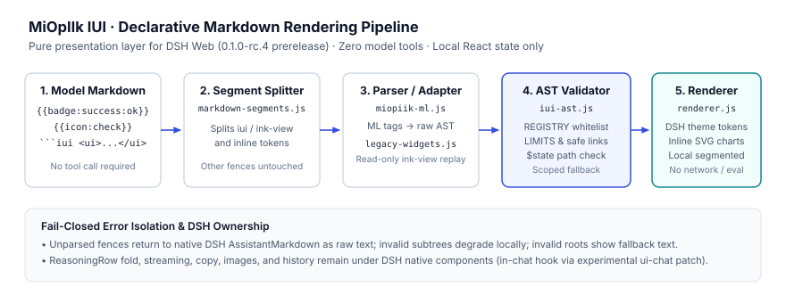

# MiOpIIk IUI


[English](README.md) | **简体中文**

> **Version 0.2.0-rc.2 — 预发布候选。**
> 本版本为本地候选，未发布到 npm registry，属于独立插件而非 DeepSeek Harness 上游内置功能；聊天内联渲染依赖对 `@deepseek-ai/dsh-client-ui-chat` 的**非官方、版本耦合补丁**。详见[发布状态](#发布状态)。

MiOpIIk IUI 是 DeepSeek Harness（DSH）Web 的纯表现层插件。模型输出包含受信行内 token 与受控 `iui` 围栏的普通 Markdown，浏览器将其渲染为声明式界面组件。本插件不依赖 MiOpIIk 的 Mind/Ink/Operator Agent，不维护账本，也不注册模型工具。

消息正文、思考折叠、图片、历史记录、流式输出、复制与无障碍结构仍由 DSH 原生聊天组件负责。

- 行内 token：`{{badge:success:通过}}`、`{{icon:check}}`、`{{code:npm test}}`
- `iui` 围栏：支持 `miopiik-ml` 标签语法或经校验的 `iui/1` JSON AST
- 受控声明式组件白名单、本地 `$state` 状态绑定与浏览器内交互控件（`segmented`/`toggle`/`slider`/`input`，配合 `when`/`is` 显隐与表格 `filter`）
- 旧 `ink-view` Widget JSON 的只读兼容回放，历史会话零迁移
- DSH 原生插件页单面承载全部可调项与状态：浏览器本地渲染开关、实时预览、状态行与可复制示例

模型仅能输出白名单内的声明式标签与结构化数据；任意 HTML、JavaScript、CSS、网络请求、工具调用与模型回合触发均在解析和校验层被拦截。

## 发布状态

**0.2.0-rc.2** 新增有界数组计算、本地按钮动作与自定义矢量绘图。见[程序与绘图示例](docs/PROGRAMMABLE-IUI.md)。

已知限制：

1. **非官方、版本耦合的宿主补丁。** 聊天内联渲染需要由 [tools/fork-chat-embeds.mjs](tools/fork-chat-embeds.mjs) 基于特定 DSH 版本（`0.2.2-rc.1`）生成的本地 `@deepseek-ai/dsh-client-ui-chat` fork。DSH 上游尚未提供 Markdown 嵌入 API。未加载该补丁时，聊天中的 `iui` 围栏按普通代码块显示，插件页预览仍可使用，设置页诊断会显式报告未检测到补丁。
2. **无多版本兼容矩阵。** 当前仅针对 DSH `0.2.2-rc.1` 基线验证，尚未建立跨多个 DSH 版本的兼容矩阵与干净 profile 冷启动全链路验证。

原先同列的两项已在 `0.1.0-rc.12` 解除：**跨 token Markdown 有损**改为 DOM 级嫁接（原生 Markdown 先渲染整段，再把行内 token 原位替换——加粗/斜体、选中复制与朗读顺序跨 token 保留），**流式非增量**改为围栏级增量（`iui` 围栏开启后逐段成形、闭合定稿、无入场动画）。残余差异见 [docs/SUPPORT-MATRIX.md](docs/SUPPORT-MATRIX.md)。

v1 候选门禁清单见 [docs/IUI-V1-RELEASE-CANDIDATE.md](docs/IUI-V1-RELEASE-CANDIDATE.md)，各版本 blocker 记录见 [docs/RELEASE-NOTES.md](docs/RELEASE-NOTES.md)。

## 与 MiOpIIk Agent 的对比

MiOpIIk 拆分为两个独立仓库，可同装或单装，互不依赖。

| | **MiOpIIk IUI**（本仓库） | **MiOpIIk Agent** |
|---|---|---|
| 包 | `miopiik-iui` 0.2.0-rc.2，预发布 | `miopiik-dsh` 0.1.2，stable |
| 层次 | 纯表现层：浏览器侧的受信 Markdown 片段 | host 侧：记忆、治理、后台执行 |
| 主要面 | 行内 token、`iui` 围栏、声明式组件、本地状态 | `ink_*` 工具面、收件箱/事实/开环/鱼骨账本、Operator 派发 |
| 状态 | 浏览器 `localStorage` 中的单个渲染偏好 | 工作区 `.dsh/miopiik/` 下的 append-only JSONL 账本 |
| 模型工具 | 无 | 14 个（Mind 12 个 + Operator 2 个） |
| 聊天所有权 | 原生 DSH `AssistantMarkdown` / `ReasoningRow` | 会话视图、右侧栏、插件页与设置页；不渲染 IUI |
| 安装条件 | DSH Web profile；聊天内联渲染需实验性 chat 包补丁 | DSH Web profile |
| 仓库 | https://github.com/Chillizu/miopiik-iui | <https://github.com/Chillizu/miopiik> |

### 仓库拆分说明

本仓库通过 `git subtree split -P miopiik-iui` 从原 MiOpIIk monorepo 提取，保留 13 个 IUI 提交历史。Agent 包位于独立仓库 <https://github.com/Chillizu/miopiik>。拆分前旧仓库中的 `miopiik-iui-v...` Release 及其下载链接继续有效。历史会话数据零迁移、不改写：旧 `ink-view` 内容在渲染时由只读 adapter 映射回放（见[旧协议回放](#旧-ink-view-协议回放)）。迁移溯源见 [docs/MIGRATION.md](docs/MIGRATION.md)。

## 架构



```text
模型输出（普通 Markdown）
  |
  |  shared/markdown-segments.js   切出 iui / ink-view 围栏与行内 token；
  |                                其他代码围栏、行内代码原样保留
  v
  L-- shared/miopiik-ml.js         iui 围栏里的 miopiik-ml -> 原始 AST 文档
  |   （或 iui/1 JSON 围栏）       JSON AST 保留作调试/兼容入口
  v
  shared/iui-ast.js                validateAst()：组件白名单、属性、
  |                                绑定路径、预算、安全链接、局部降级
  v
  renderer.js                      React 组件注册表；主题 token、内联 SVG
  |
  v
浏览器                            只有本地 React 状态；无网络、无模型往返
```

文件与职责：

| 文件 | 作用 |
|---|---|
| [index.js](index.js) | host 入口。注入一节 system prompt（`miopiik-iui:render-contract`，order 670，关闭变量插值），定义精简输出约定；不注册工具。 |
| [shared/markdown-segments.js](shared/markdown-segments.js) | 无状态切分器：切分围栏块与行内 token；模型漏写围栏时兼容识别行首顶层 `<ui>...</ui>`。 |
| [shared/miopiik-ml.js](shared/miopiik-ml.js) | `miopiik-ml` 标签语法解析器，产出待校验的 AST 文档。 |
| [shared/iui-ast.js](shared/iui-ast.js) | `iui/1` 校验器：`REGISTRY` 白名单、`LIMITS` 预算、绑定路径解析、表格/图表归一与局部降级。 |
| [shared/legacy-widgets.js](shared/legacy-widgets.js) | 只读适配器，将已退役的七 Widget `ink-view` JSON 映射为 `iui/1` AST。 |
| [renderer.js](renderer.js) | 校验后 AST 的 React 渲染器与行内原语，打包进 `client.js`。 |
| [settings.js](settings.js) | 唯一 DSH 界面入口（`plugins.bundle.config`，key `miopiik-iui`）：渲染开关、实时预览、状态行与可复制示例。 |
| [client.js](client.js) | 生成的浏览器 bundle；通过 `node tools/build.mjs` 重新生成。 |
| [cordis.patch.yml](cordis.patch.yml) | 供 DSH profile 加载插件的 bundle patch。 |

### 宿主侧补丁

由于当前 DSH 尚未提供官方 Markdown 嵌入扩展点，仓库提供确定性的补丁生成脚本来挂载聊天内渲染钩子：

1. [tools/fork-chat-embeds.mjs](tools/fork-chat-embeds.mjs) 将已安装的 `@deepseek-ai/dsh-client-ui-chat` 复制到 `upstream/dsh-client-ui-chat-embeds/`（生成物，已 gitignore），并在 `AssistantMarkdown` 的 `case "text"` 分支插入一处受控挂钩。
2. 脚本将精确差异输出至 [patches/chat-markdown-embeds.patch](patches/chat-markdown-embeds.patch)，对生成文件执行 `node --check`，并将 fork 目录下的 `node_modules` 软链到 DSH 依赖树。
3. 原生 `AssistantMarkdown`、`ReasoningRow`（折叠、摘要、流式、无障碍）、图片、附件、复制与回放保持原样；仅匹配受信标记的文本片段交由插件渲染。
4. 挂钩采用 fail-closed 策略：当插件注册表未加载、浏览器偏好关闭或渲染抛错时，片段回退为原生 Markdown 或纯文本兜底。挂钩同时设置 `globalThis.__miopiikMarkdownEmbedsHost = true`，供设置页检测补丁状态。

该补丁属于**非官方、版本耦合的实验性方案**。生成脚本通过源码锚点匹配目标位置，当上游包结构变化时会直接报错退出。升级 DSH 后需重新运行生成脚本，且仅在目标 profile 的 `node_modules` 中建立软链，不修改全局 DSH 安装目录。

## 可以写什么

### 行内 token

可在普通段落中使用以下三种行内 token：

| token | 含义 |
|---|---|
| `{{badge:success:通过}}` | 语义徽章，tone 支持 `neutral`、`success`、`warning`、`danger`，后接文本；省略 tone（如 `{{badge:草稿}}`）时默认为 `neutral`。 |
| `{{icon:check}}` | 内置图标：`check`、`alert`、`dot`、`arrow-right`、`spark`、`chart`、`layers`、`shield`、`clock`、`inbox`、`info`；未知名称降级为 `dot`。 |
| `{{code:npm test}}` | 行内等宽代码文本，按字面原样显示。 |

payload 长度上限为 120 字符，不含花括号或换行。其他代码围栏内的文本不会被切分；单反引号行内代码中的 token 仍会被匹配（见[局限](#局限)）。

### `iui` 围栏

代码块围栏语言标识写为 `iui`，支持两种内容格式：

- **`miopiik-ml`**（首选）：小型类 XML 标签语法，先编译为 AST，再进入 `validateAst` 校验。
- **`iui/1` JSON AST**：包含 `root` 节点的 JSON 对象，供调试与兼容使用，经同一套校验器校验。

另有第三条围栏通道承载完整静态 HTML 文档：**`html` 围栏**渲染为**无脚本沙箱 iframe**（`sandbox="allow-same-origin"`、**绝不含 `allow-scripts`**，另注入 CSP `default-src 'none'`）——文档的 CSS/SVG 排版全量呈现，JavaScript 一行不执行、零网络、≤256KB；高度按文档内容自动收紧（120–1600，超出内部滚动），`<!-- height: 480 -->` 只作首次绘制高度，尺寸不可拖拽。渲染时从宿主采样设计令牌注入预设样式，并预置 `mi-card` / `mi-row` / `mi-grid` / `mi-metric` / `mi-badge` / `mi-callout` / `mi-progress` / `mi-divider` 等组件类与 `data-tone=success|warn|danger|brand`——文档天然与 DSH 本体同风格，文档自带 `<style>` 仍可覆盖预设。「模型输出永不执行」的规则不变，只是由浏览器引擎在文档级强制执行。

`miopiik-ml` 使用标签表示组件、属性表示 props、JSON 字面量表示结构化数据、`$state.*` 表示本地状态绑定：

```iui
<ui title="周活跃" fallback="周一 12，周二 19">
  <state name="range" value='{"total":"31"}'/>
  <column gap="md">
    <metric label="累计" value="$state.range.total" unit="次"/>
    <chart kind="line" series='[["周一",12],["周二",19]]' source="演示数据"/>
  </column>
</ui>
```

语法规则：

- 根标签为 `<ui>`，`title` 与 `fallback` 可选；整块校验失败时显示 `fallback` 文本。
- `<state>` 支持 `<state name="range" value='{"...":...}'/>` 或 JSON 正文 `<state>{"range":{...}}</state>`。
- 属性值支持引号字符串、JSON 字面量（`options='[...]'`、`rows='[...]'`）、数字、布尔值及 `$state.*` 绑定路径。
- `gap` 支持 `none`、`xs`、`sm`、`md`、`lg`、`xl` 或数字。`chart` 支持 `kind="bar"`、`kind="line"` 或 `kind="donut"`；旧写法 `type`/`data` 会自动归一为 `kind`/`series`。
- 当模型漏写代码围栏时，行首顶层 `<ui>...</ui>` 也可被容错识别。

### 组件清单

| 组件 | ML 标签 | 说明 |
|---|---|---|
| 根 | `ui` | 包裹单个块；支持 `title`、`fallback`。 |
| 状态声明 | `state` | 声明本地初始状态；不生成 DOM 节点。 |
| 文本 | `text` | 纯文本节点。 |
| 段落 | `p`、`paragraph` | 仅包含行内原语：`text`、`badge`、`icon`、`emphasis`、`code`、`link`。 |
| 徽章 | `badge` | `text`、`tone`（`neutral`、`success`、`warning`、`danger`、`info`、`accent`），行内与块级通用。 |
| 图标 | `icon` | 置于 `p`/`paragraph` 内或作为 `empty.icon`；支持 `name`、`label`。 |
| 强调 | `b`、`emphasis` | 置于 `p`/`paragraph` 内；支持 `text`、`strong`。 |
| 代码 | `code` | 置于 `p`/`paragraph` 内；支持 `text`，行内等宽显示。 |
| 链接 | `a`、`link` | 置于 `p`/`paragraph` 内；支持 `text`、`href`（仅限 `https://...`、站内 `/...` 或 `#anchor`）。 |
| 行/列 | `row`、`column` | 布局容器；支持 `gap`、`align`。 |
| 网格 | `grid` | 支持 `columns`（1-6）、`gap`、`align`。 |
| 卡片 | `card` | 容器；支持 `title`、`subtitle`、`gap`、`span`、`align`。 |
| 分隔 | `divider` | 可选 `label`。 |
| 指标 | `metric` | 支持 `label`、`value`、`unit`、`delta`、`caption`/`note`、`tone`；值可绑定 `$state`。 |
| 表格 | `table` | `columns`（1-12 个字符串或 `{key,label}` 描述符）、`rows`（最多 200 行数组或对象）、`caption`、`filter`（绑定 `$state.*`，浏览器内本地过滤）。 |
| 图表 | `chart` | `kind`（`bar`、`line` 或 `donut`）、`series`（点列或 `$state` 绑定）、`source`；渲染为内联 SVG。 |
| 进度 | `progress` | `value` >= 0（数字或 `$state` 绑定）、`max` > 0、`label`、`tone`。 |
| 提示条 | `callout` | `tone`、`title`、`text`；可含子节点。 |
| 空状态 | `empty` | `text`/`title`/`description`、`icon`。 |
| 分段控件 | `segmented` | 本地单选控件；`bind`（必须为 `$state.*`）、1-6 个 `options`、`label`。 |
| 开关 | `toggle` | 本地布尔控件，写入 `$state.*`；支持 `bind`、`label`。 |
| 滑杆 | `slider` | 本地数值控件，写入 `$state.*`；支持 `bind`、`min`、`max`、`step`（正数）、`unit`、`label`。 |
| 输入框 | `input` | 本地文本控件，写入 `$state.*`（受单节点文本预算约束）；支持 `bind`、`placeholder`、`label`。 |
| 步骤 | `steps` | 有序过程清单；仅接受 `step` 子节点。 |
| 步骤项 | `step` | `title`（必填）、`note`、`tone`（共用六色 tone 枚举）。 |
| 泳道图 | `diagram` | 结构图形；`title`、`source`。泳道 ≤6 列、节点 ≤24、连线 ≤24。 |
| 泳道列 | `lane` | 一列；仅接受 `node` 子节点（1-8 个）。 |
| 图节点 | `node` | `id`（必填、图内唯一、安全标识符）、`label`（必填）、`tone`、`note`；也可直接写在 `diagram` 里（汇成首列）。 |
| 图连线 | `edge` | `from`/`to`（节点 id）、`label`、`kind`（默认 `solid` / `dashed`）。未知引用只降级该边；纯文本行按注释渲染。 |

任何组件都可写 `when="$state.*"`（可配 `is="值"` 做等值切换），按本地状态控制自身显隐。组件白名单由 [shared/iui-ast.js](shared/iui-ast.js) 的 `REGISTRY` 强制执行，未知标签会局部降级。

### 本地状态与绑定

绑定仅支持点号路径读取：`$state.a.b` 与 `$data.a.b`，不支持表达式求值、函数调用或 `eval`。交互只有一个模型：**控件写 `$state`，其余读 `$state`**——`segmented`（单选）、`toggle`（布尔）、`slider`（数值）、`input`（文本）把控件值写入 `$state.*` 路径；任意属性可读 `$state.*`；`when`/`is` 控制节点显隐；`table filter` 在浏览器内过滤行。所有交互只更新当前消息内的本地 React 状态并重算关联节点，不发送消息、不调用工具、不触发模型回合。当前客户端未接入外部数据通道，`data` 作用域为空（`$data.*` 解析为缺失值），预留给后续只读数据注入。

### 旧 `ink-view` 协议回放

旧 `ink-view` 七 Widget 协议（`dataset`、`graph`、`timeline`、`text`、`choice`、`media`、`layout`）已退役。历史会话数据零迁移：渲染前由 `shared/legacy-widgets.js` 将 fenced `ink-view` JSON 只读映射为 `iui/1` AST 回放。无法映射的 spec 保留原始文本显示（不使用旧 spec 的 `fallback` 字段），`choice` 动作仅显示为静态选项文本，且不写回会话或账本。旧协议的设计历史归档于 [docs/EXTRA-UI.md](docs/EXTRA-UI.md)。

### 插件页

插件只注册一个 DSH 界面入口：**插件 → 已安装 → MiOpIIk IUI**（`plugins.bundle.config`）。用户能调整和想看的都在这一页——不注册设置页页签，不写小作文：

- **渲染开关**：浏览器本地「在聊天中显示 IUI」偏好（单开关，存 `localStorage`，切换后刷新页面让历史消息重渲）。
- **实时预览**：真实渲染器 + 演示数据；切换只改本地状态。
- **状态行**：插件版本、宿主补丁状态（已加载 / 未检测到）、渲染器连接。
- **可复制示例**：可直接粘贴测试的 Markdown 片段。

### 校验、预算与错误隔离

`validateAst` 集中执行结构校验与资源限制：

- 组件白名单校验与各类型属性归一化。
- 资源预算：最多 120 个节点、深度 6、图表 60 个点、segmented 6 个选项、单文本节点 2000 字符、state/table 载荷 16384 字节、表格 200 行、12 列。
- 拒绝绑定路径、状态对象与表格列中的原型污染属性名（`__proto__`、`constructor`、`prototype`）。
- 根节点非法、超深或节点数超限时整块拒绝（fail-closed），展示该块的 `fallback` 文本。
- 语法无法解析的围栏交回原生 Markdown 按原始文本展示。
- 子树校验失败时仅将该子树降级为文本节点，同级与父级布局保持正常渲染。
- 挂钩边界捕获到运行异常时，回退为带 `data-miopiik-embed-fallback` 属性的纯文本节点。

## 用法示例

模型直接在 Markdown 回复中输出以下内容，无需调用工具。

行内 token 与正文混排：

~~~md
构建 {{badge:success:通过}}，耗时 {{badge:neutral:42s}}；状态 {{icon:check}}。
本地验证命令：{{code:npm test}}
~~~

包含本地状态、指标、图表、表格与分段控件的 `iui` 围栏块：

~~~md
这轮发布检查的结果 {{badge:success:2/3}}：

```iui
<ui title="发布检查" fallback="本轮 3 项检查：解析通过、校验通过、渲染观察中">
  <state name="range" value='{"total":"3","passed":"2","series":[["解析",12],["校验",9],["渲染",7]]}'/>
  <column gap="md">
    <row gap="md">
      <metric label="检查项" value="$state.range.total" unit="项"/>
      <metric label="已通过" value="$state.range.passed" unit="项" tone="success" delta="+1"/>
    </row>
    <segmented label="轮次" bind="$state.range" options='[{"label":"本轮","value":{"total":"3","passed":"2","series":[["解析",12],["校验",9],["渲染",7]]}},{"label":"上轮","value":{"total":"3","passed":"1","series":[["解析",11],["校验",8],["渲染",6]]}}]'/>
    <grid columns="2">
      <chart kind="bar" series="$state.range.series" source="演示数据"/>
      <table columns='["检查","结果"]' rows='[["解析","通过"],["校验","通过"],["渲染","观察中"]]'/>
    </grid>
  </column>
</ui>
```
~~~

等效的 `iui/1` JSON AST 格式：

~~~md
```iui
{"version":"iui/1","title":"组件使用","fallback":"组件使用：metric 2，chart 1","state":{},"root":{"id":"root","type":"column","props":{"gap":10},"children":[{"id":"m1","type":"metric","props":{"label":"组件","value":"3","unit":"个"},"children":[]},{"id":"t1","type":"table","props":{"columns":["类型","数量"],"rows":[["metric",2],["chart",1]]},"children":[]}]}}
```
~~~

[index.js](index.js) 注入的系统提示词约定：默认优先使用普通 Markdown，仅在数据对比、趋势展示或本地视图切换更清晰时输出 IUI，且不为渲染界面去查找源码或调用工具。相关审计记录见 [docs/IUI-NATURAL-OUTPUT-AUDIT.md](docs/IUI-NATURAL-OUTPUT-AUDIT.md)。

## 支持范围

| 项 | 要求 |
|---|---|
| DSH | 仅 DSH Web（`web` profile）。测试基线：DSH `0.2.2-rc.1`。 |
| Node.js | `>= 23.6`（`package.json` `engines`）。 |
| DSH CLI | `dsh plugin --profile <profile> add/remove`。 |
| 浏览器 | Chromium（隔离 DOM 测试环境）。 |

完整支持矩阵见 [docs/SUPPORT-MATRIX.md](docs/SUPPORT-MATRIX.md)。

## 安装、升级、回滚

请在独立 DSH profile 中验证本候选。聊天内联渲染依赖从此 checkout 生成的本地宿主补丁。

### 前置条件

- 可修改 profile 的 DSH Web 安装（基线 `0.2.2-rc.1`）。
- Node.js `>= 23.6`，且 `PATH` 中包含 `dsh` CLI。
- 本仓库的本地 checkout。

### 安装

1. 将插件加入目标 profile：

   ```sh
   dsh plugin --profile <profile> add /absolute/path/to/miopiik-iui
   ```

   或使用本地打包的 tarball：

   ```sh
   npm pack --pack-destination .dsh/tmp/packs
   dsh plugin --profile <profile> add .dsh/tmp/packs/miopiik-iui-0.2.0-rc.2.tgz
   ```

   也可使用封装脚本 [tools/install-plugin.mjs](tools/install-plugin.mjs)（默认 dry-run；写入运行中的 `web` profile 需显式加 `--allow-running-profile`）：

   ```sh
   node tools/install-plugin.mjs --profile <profile> --mode link            # dry-run
   node tools/install-plugin.mjs --profile <profile> --mode link --execute  # 实际执行
   ```

2. 校验浏览器 bundle 与源码同步：

   ```sh
   node tools/build.mjs --check
   ```

3. 从 DSH 安装目录生成 `ui-chat` 补丁 fork（自动探测常见全局 npm 前缀，或通过 `MIOPIIK_DSH_DIR` 指定）：

   ```sh
   MIOPIIK_DSH_DIR=/path/to/dsh/installation node tools/fork-chat-embeds.mjs
   MIOPIIK_DSH_DIR=/path/to/dsh/installation node tools/fork-chat-embeds.mjs --check
   ```

   生成产物位于 `upstream/dsh-client-ui-chat-embeds/`（已 gitignore），补丁差异写入 [patches/chat-markdown-embeds.patch](patches/chat-markdown-embeds.patch)（可通过 `MIOPIIK_FORK_DIR` 与 `MIOPIIK_FORK_PATCH` 覆盖）。`--check` 为只读校验，在无 DSH 安装或尚未生成 fork 的机器上返回退出码 `0`。请仅在无运行中任务加载该目录时生成或更新 fork。详情见 [docs/UPSTREAM-MARKDOWN-EMBED.md](docs/UPSTREAM-MARKDOWN-EMBED.md)。

4. 将目标 profile 下的 `@deepseek-ai/dsh-client-ui-chat` 软链指向生成的 fork（保持全局 DSH 安装目录不变）：

   ```sh
   cd <profile>/node_modules/@deepseek-ai
   [ -e dsh-client-ui-chat ] && mv dsh-client-ui-chat dsh-client-ui-chat.bak
   ln -s /absolute/path/to/miopiik-iui/upstream/dsh-client-ui-chat-embeds dsh-client-ui-chat
   ```

5. 重启该 profile 的 DSH Web 服务并刷新浏览器，在 **Plugins -> Installed -> MiOpIIk IUI** 中确认状态。

### 升级

1. 将目标 profile 的依赖更新为新版本路径或 tarball（`dsh plugin --profile <profile> add <新 checkout 或 tarball>`）。
2. 在新版本目录执行 `node tools/build.mjs --check`。
3. 若 DSH 版本已升级，重新执行 `node tools/fork-chat-embeds.mjs` 与 `--check`。
4. 重启 DSH Web。历史消息无需迁移，查看时按新版本渲染。

### 卸载

1. 从 profile 移除插件：

   ```sh
   dsh plugin --profile <profile> remove miopiik-iui
   ```

2. 将 `<profile>/node_modules/@deepseek-ai/dsh-client-ui-chat.bak` 移回原名。
3. 重启 DSH Web，聊天恢复为原生 Markdown 渲染。

### 回滚

- **快速关闭渲染（无需重启服务）：** 在 **插件 → 已安装 → MiOpIIk IUI** 关闭开关，或在浏览器控制台执行：

  ```js
  localStorage.setItem("miopiik.markdownEmbeds", "0"); location.reload()
  ```

- **完整回滚：** 按[卸载](#卸载)步骤移除插件并恢复原 `ui-chat` 软链，重启 DSH Web。

### 未打补丁时

当仅安装 `miopiik-iui` 插件而未挂载 `ui-chat` fork 时：

- 聊天中的 `iui` 围栏按普通代码块显示，行内 token 按字面文本显示。
- 插件页与页面内的实时预览正常工作。
- 设置页诊断显示「未检测到补丁 · 仅设置页预览可用」。
- host 侧提示词约定仍会注入，模型输出的 IUI 块在挂载补丁前均以代码块呈现。

## 配置

| 项 | 位置 | 作用 |
|---|---|---|
| 浏览器偏好 `miopiik.markdownEmbeds` | 浏览器 `localStorage` | `"0"` 关闭当前浏览器的聊天内 IUI 渲染；其他值或未设置时开启。切换后自动刷新页面。 |
| 渲染开关（UI） | **插件 → 已安装 → MiOpIIk IUI** | `miopiik.markdownEmbeds` 的界面开关，仅作用于当前浏览器。 |
| 宿主补丁标记 `globalThis.__miopiikMarkdownEmbedsHost` | 浏览器 `globalThis` | `ui-chat` 挂钩加载时置为 `true`，供设置页诊断读取。 |
| 嵌入注册表 `globalThis.__miopiikMarkdownEmbeds` | 浏览器 `globalThis` | 由 `client.js` 注册（含 `segments`、`renderInline`、`renderBlock`）。 |
| bundle patch `cordis.patch.yml` | 包根目录（`dsh.bundle.patch`） | 向 DSH 声明 host 与 client 入口。 |

浏览器渲染开关仅控制前端呈现；插件在 profile 中启用期间，`index.js` 的系统提示词片段保持注入。

## 安全与权限

- **组件白名单。** 模型输出经解析和校验后生成受控 `iui/1` AST，阻断任意 HTML、`innerHTML`、`eval`、动态样式表与脚本注入。
- **零网络请求。** 图表渲染为内联 SVG，图标使用内置字形，不发起 `fetch`、XHR、WebSocket 或外部资源加载。
- **纯本地交互。** `segmented`、`toggle`、`slider`、`input` 等控件仅更新当前消息的本地 React 状态，不调用工具、不发送消息、不触发模型回合。
- **无自定义事件处理器。** 忽略模型传入的任意 `on*` 属性。
- **资源预算与键名过滤。** 限制节点数、树深度、图表点数、选项数、文本长度及表格/状态字节大小；过滤 `__proto__`、`constructor`、`prototype` 等危险键名。
- **受限链接协议。** 链接仅允许 `https://...`、站内 `/...` 与 `#anchor`。
- **局部错误隔离。** 非法子树局部降级为文本节点；非法根节点回退为 `fallback` 文本；挂钩异常回退为纯文本 span，其余 Markdown 正文保持原样。
- **零日志写入。** 插件不写磁盘日志或工作区文件，仅在浏览器 `localStorage` 保存渲染开关偏好。

## 测试与开发

```sh
npm test                      # node --test —— 离线单元与结构测试
npm run check                 # npm pack + 解包 + 逐文件语法 + import 图覆盖检查
npm run build:check           # 校验 client.js 与源码一致
npm run icon:check            # 图标资产静态检查
node tools/fork-chat-embeds.mjs --check
```

- `npm test` 完全离线运行，覆盖切分器、`miopiik-ml` 解析、`iui/1` 校验、表格/图表归一、旧协议只读映射、设置页 bundle 与发布就绪检查。
- 当本机可解析到 DSH 安装（或设置 `MIOPIIK_DSH_DIR`）时运行 fork 生成器回归测试，否则自动 skip；只读 `--check` 的无宿主路径始终执行。
- 当本机存在 Chromium（或设置 `CHROMIUM_PATH` / `MIOPIIK_CHROMIUM`）时运行插件页与设置页的隔离 DOM 测试，否则自动 skip。
- `tools/` 下的端到端脚本（`e2e-gallery-replay.mjs`、`e2e-iui-user-sessions.mjs`、`e2e-playwright.mjs`、`e2e-dual-settings.mjs`、`e2e-legacy-replay.mjs`、`e2e-iui.mjs`、`e2e-iui-model.mjs`）需配合运行中的本地 DSH Web 使用，说明见 [docs/DEV-TOOLS.md](docs/DEV-TOOLS.md)。
- CI（[.github/workflows/ci.yml](.github/workflows/ci.yml)）在 Node 23.6.0、24.x、26.x 上执行单测、`npm run check`、`npm run build:check` 与 `npm run icon:check`。

## FAQ

**为什么 `0.1.1` 是正式版，却仍然要打宿主补丁？**

两项 stable blocker 尚未解除：聊天内联渲染依赖非官方、版本耦合的 `@deepseek-ai/dsh-client-ui-chat` 补丁；尚无跨版本兼容矩阵。此前的跨 token Markdown 有损与流式非增量已在 `0.1.0-rc.12` 解除。详见 [docs/IUI-V1-RELEASE-CANDIDATE.md](docs/IUI-V1-RELEASE-CANDIDATE.md)。

**不打 chat 补丁会怎样？**

插件仍可安装，插件页实时预览正常渲染，设置页诊断显示「未检测到补丁 · 仅设置页预览可用」；聊天中的 `iui` 围栏显示为普通代码块，行内 token 显示为字面文本。

**会影响历史会话数据吗？**

不会。会话日志保持原始 Markdown 文本不变；旧 `ink-view` 围栏在渲染时做内存只读映射，不写回账本；关闭渲染开关即可恢复原始 Markdown 显示。

**需要同时安装 MiOpIIk Agent 吗？**

不需要。`miopiik-iui` 与 `miopiik-dsh` 彼此独立，可单独或同时安装。

**关闭渲染开关后消息会发生什么变化？**

仅改变当前浏览器的显示方式：`iui` 围栏显示为代码块，行内 token 显示为普通文本，底层会话消息不变。

## 局限

- **单反引号行内代码中的 token 会被识别。** 切分器在普通段落（含单反引号内文本）匹配行内 token；展示字面 token 示例请使用围栏代码块。
- **跨 token Markdown 有损。** 行内 token 会切分 Markdown 文本块，跨越 token 边界的加粗/斜体等格式会断开，选中复制与屏幕阅读器朗读顺序与单节点 Markdown 存在差异。
- **流式非增量。** 未闭合的 `iui` 围栏在流式期间按纯文本显示，闭合后一次性渲染。
- **版本耦合的实验性补丁。** 宿主挂钩基于 DSH `0.2.2-rc.1` 的 `ui-chat` 包锚点生成，DSH 升级后需重新生成。
- **本地 fork 不可作为官方包发布。** `upstream/dsh-client-ui-chat-embeds/` 仅供本地受控 profile 链接使用。
- **旧 `ink-view` 仅做只读回放。** 七 Widget 协议已退役；历史数据零迁移，由只读 legacy adapter 映射回放，`choice` 动作不执行，无法映射的 spec 保留原始文本（不使用旧 spec 的 `fallback` 字段），不写回账本。
- **无多版本与完整无障碍矩阵。** 当前仅覆盖 DSH `0.2.2-rc.1` 及基础深色/窄屏检查，未完成完整主题与屏幕阅读器测试矩阵。
- **模型输出受提示词引导。** 输出约定通过 system prompt 注入，模型遵从率分析见 [docs/IUI-NATURAL-OUTPUT-AUDIT.md](docs/IUI-NATURAL-OUTPUT-AUDIT.md)。

## 贡献

- 修改协议与校验请编辑 `shared/`，修改组件请编辑 `renderer.js`，随后执行 `node tools/build.mjs` 重新生成 `client.js` 并一并提交。
- 请勿直接手改 `client.js`、`patches/chat-markdown-embeds.patch` 或 `upstream/`。
- 保持零第三方运行时依赖；新增组件需包含白名单注册、属性校验、预算限制、降级逻辑与单元测试。
- 提交 PR 前运行 `npm test`、`npm run check`、`npm run build:check` 与 `npm run icon:check`。
- 保持 `icon.svg` 与原稿逐字节一致（由 `npm run icon:check` 校验）。

## 许可

MIT。见 [LICENSE](LICENSE)。
